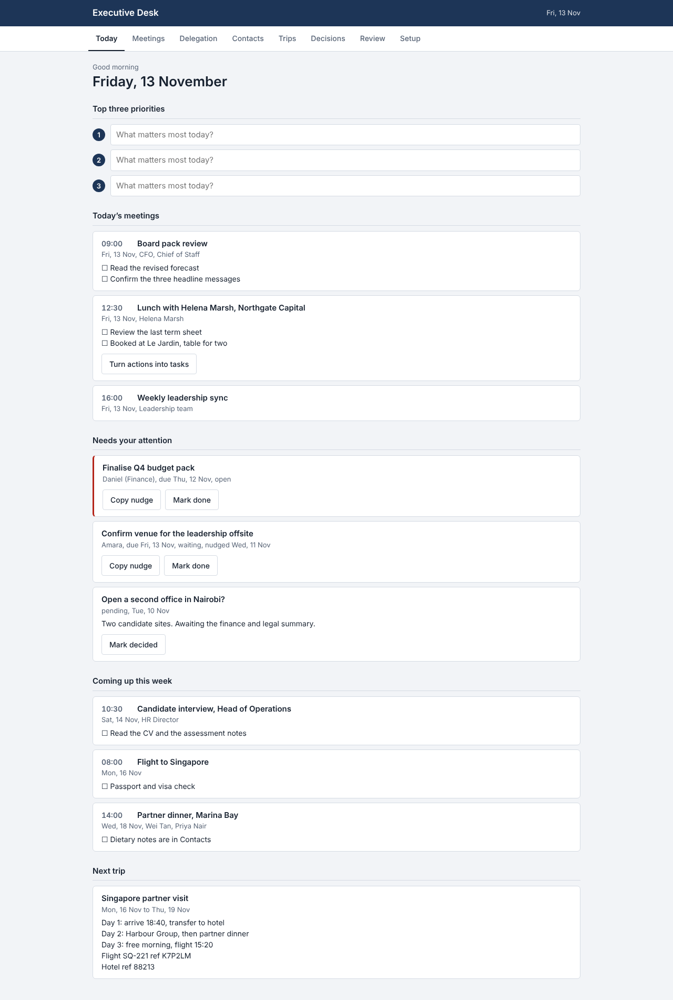

# Executive Desk

A private daily planner for executives and their chiefs of staff. One file. No accounts, no database, no subscription to a third-party service.

## What it does
- **Today:** the date, three priorities, today's meetings with prep checklists, and everything that needs attention (overdue delegations, pending decisions).
- **Meetings:** attendees, prep checklist, notes, and action items that turn into tasks in one tap.
- **Delegation:** who owes what, by when, with a ready-written follow-up message to copy.
- **Contacts:** travel and dining preferences, last interaction.
- **Trips:** day-by-day itineraries with confirmation references.
- **Decisions:** a log of what is pending and what was decided.
- **Weekly review:** a one-page printable summary.
- **Calendar:** import any calendar as a .ics file, or connect a private calendar link that refreshes automatically (see docs/SETUP.md).
- **Your brand:** name, logo and accent colour are set in Setup, in light or dark mode.

## Privacy
All information is stored in the user's own browser on their own device. Nothing is sent to the seller. If live calendar feeds are switched on, calendar data passes through the relay you deploy, which stores nothing.

## Get started in 3 steps
1. **Open it.** Double-click `index.html`. It opens in your browser.
2. **Make it yours.** Open Setup, enter your name or company, upload a logo, and choose a colour.
3. **Add your day.** Add meetings and delegations, or bring in your calendar by file (Setup, Connect any calendar).

Full step-by-step instructions, written for non-technical users, are in **[docs/SETUP.md](docs/SETUP.md)**:
- Part 1: try it in 2 minutes
- Part 2: put it online
- Part 3: bring your calendar in by file
- Part 4: automatic calendar updates (optional)

A one-page guide for everyday use is in [docs/CLIENT-QUICKSTART.md](docs/CLIENT-QUICKSTART.md).

## Support
Email zaydien@gmail.com.

## Good to know
- Data lives in one browser on one device. Clearing browser data erases it, so back up regularly.
- Live calendar links are refreshed by Google, Microsoft and Apple on their own schedule. Changes can appear hours late.
- It is a planner. It does not send email, and it does not use AI.

## Licence
Licensed by Zaydien Williams for up to 4 named users, for the licensee's own use. All sales are final. Governed by the laws of South Africa. See [LICENSE.txt](LICENSE.txt).
